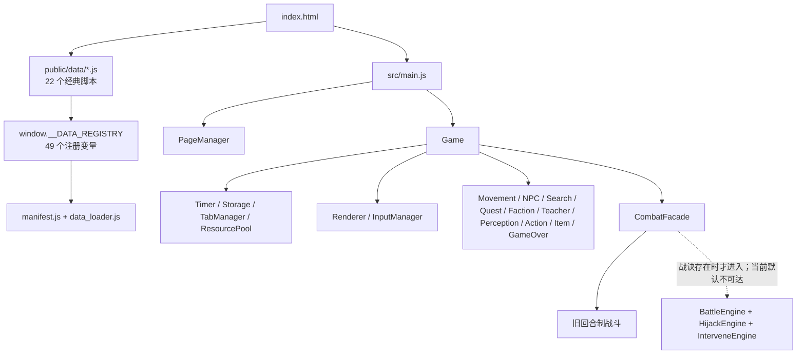

# GhostMUD 项目与设计文档差异审计

审计日期：2026-07-06

## 1. 结论摘要

项目不是“没有实现”，而是处于**大量内容与引擎代码已生成，但主流程接线、数据契约、验收和文档治理没有闭环**的状态。

综合健康度：**43/100（高风险原型，可演示，不宜按已完成产品继续堆功能）**。

| 维度 | 分数 | 结论 |
|---|---:|---|
| 架构与模块化 | 65/100 | Game 已拆成 11 个服务，方向正确；仍高度依赖 `window`、DOM 和隐式数据契约 |
| 功能闭环 | 38/100 | 移动、搜索、NPC、旧战斗等可运行；身份、灵修、行功、装备等多为“有代码但不可达” |
| 数据完整性 | 54/100 | 22 个数据脚本全部加载，203 房间连接目标完整；地图、命名、描述分层仍有系统性缺口 |
| UI/UX | 46/100 | 五页移动端框架已实现；武学和舆图页运行时报错，桌面双栏未实现，顶栏是假按钮 |
| 测试与发布 | 18/100 | 构建通过但有生产 404 警告；无 npm test/lint，3 个验证脚本不可运行，旧验证已漂移 |
| 文档可信度 | 20/100 | 多个“已完成”声明与当前代码直接矛盾，且“唯一活文档”不是最新决策来源 |

## 2. 项目结构与模块关系

优点：

- `src/game.js` 已从 2078 行拆到 869 行，11 个服务模块边界基本清楚。
- 数据注册表替代了早期 `eval` bridge，22 个运行时数据脚本本次均成功加载。
- Vite 生产构建成功，38 个模块可打包。

主要结构风险：

- `DATA_MANIFEST` 自称唯一数据清单，但 `index.html` 仍手工维护另一份脚本顺序，形成双源配置。
- `ResourcePool` 被实例化但未被状态系统消费；资源仍是 `state` 散字段。
- UI 和服务普遍直接操作 DOM、`window.game` 与全局数据，缺少可测试的接口层。
- 没有运行时 schema 校验，因此“数量正确、结构错误”直到点击页面才暴露。

## 3. 当前实际可用功能

| 功能 | 当前事实 | 状态 |
|---|---|---|
| 基础启动 | Vite 启动、数据注册、Game 初始化、定时器启动 | 可用 |
| 世界数据 | 203 房间、209 个 NPC 遭遇、60 敌人、120 物品、15 任务、11 宗门 | 已加载 |
| 基础玩法 | 移动、休憩、修行、练功、搜索、交谈、打听、旧回合制战斗 | 基本可用 |
| 五页 UI | 江湖/武学/行囊/舆图/人物，祥云切页和场景配色 | 部分可用 |
| 问剑峰 | 18 房间、四时段描述、第一章巡礼和晚饭数据 | 部分可玩 |
| 时间系统 | 5 分钟推进一个时辰、存档字段、子时竹林门禁 | 基本实现，有映射错误 |
| 身份系统 | 14 身份数据、三选一 Intro UI、应用函数 | 主流程禁用，效果大多未消费 |
| 存档 | 单槽 localStorage、移动和开场时保存 | 基础版可用，不是文档所称 v3 |
| 行功战斗 | 70 技能、异步引擎、7 状态、篡改和干预模块 | 代码存在，默认主流程不可达 |

## 4. 设计文档差异矩阵

| 设计域 | 文档目标 | 当前实现 | 差异判断 |
|---|---|---|---|
| 身份 | 14 身份，创建时 roll 3 选 1，五维影响 | 数据和 Intro UI 已写；`Game.init()` 主动跳过 Intro，随机代选 1 个；多数 `innateMods/unlocks/factionRepMods` 无消费者 | **约 30%** |
| 新手流程 | Roll → 门派选择 → 黄金三章 | 自动随机身份并强制问剑峰；仅第一章；第二章野猪/视角切换和第三章守夜均无实现 | **约 25%** |
| Tutorial 架构 | ADR 要求独立 `TutorialManager` + 独立数据文件 | 不存在 `tutorial_manager.js`；逻辑和文本混在 `wenjianfeng_tutorial_ch1.js`，由 MovementService 特判调用 | **偏离 ADR** |
| 双修体系 | 武修/灵修可转职，术语、境界、经济、敌池、任务、结局双轨 | path/术语/经济/道心基础存在；`switchPath('ling')` 明确拒绝；江湖事件和交集任务只有加载无消费 | **约 35%** |
| 三层描述 | `desc_vague/percept/awakened` 按路径和境界切换 | 分发函数存在；203 房间中 vague=0、percept=0、awakened=185，三字段齐全=0 | **引擎有，数据未闭环** |
| 行功战斗 | 五式、异步 CD、MP 门禁、状态、篡改、干预、Boss、双模 | 三个引擎模块约 3057 行，状态逻辑较完整；但默认 `state.chart=null`，路由错误地查 `XINGGONG[faction]`，实际 XINGGONG 顶层无宗门键，故回落旧战斗 | **工程量大，玩家可达约 10%** |
| 战斗技能 | 12 宗门×5 + 10 通用，Boss 和装备 v3 | 70 技能已加载；Boss/装备数据仍在 `work/`，未进入 manifest/public | **技能完成，配套未接** |
| 装备 v3 | 8 武器、12 饰品、品质、铭文、鉴定、词缀、Build | 运行时只有 weapon/armor 两槽和简单 atk/def；无鉴定、词缀、饰品和掉落生成器 | **约 10%** |
| 肉鸽 Build | 八脉、刻印、9 Build、掉落与畸变联动 | 8 经脉、35 刻印、9 Build 已加载；源码除 loader 外基本零消费 | **数据完成，玩法约 5%** |
| 异常状态 | 7 状态、交互、宗门锚点和 UI | 新战斗引擎有 7 状态及部分交互；新战斗不可达，现有战斗模态无状态展示 | **引擎部分完成，产品未交付** |
| MP 数值 v2 | 凡人 50/60，随境界到 2000/2400，按境界回复 | 初始固定 80；突破固定 +30/+40；非战斗休憩固定 +5 | **数值未同步** |
| 战斗数值 v3 | HP 20-30 起步、境界 3-5 倍增长、伤害类型克制 | 当前凡人基础 HP 约 120、旧战斗随机加伤；设计锚点未统一到主流程 | **明显不一致** |
| UI v3 | 五页、移动优先、桌面 2/3+1/3 双栏、触控 44px、场景主题 | 五页和移动主结构已实现；1280px 仍只有 720px 单页居中；顶栏按钮仅 21px；无双栏 | **约 55%** |
| 舆图 | 可拖拽缩放、迷雾、节点快速移动 | 节点渲染代码存在；4 条 MAP_CONN 引用无坐标，页面点击即异常 | **当前不可用** |
| 存档 v3 | 自动槽+3 手动槽、迁移、备份、校验、导入导出、23 触发点 | 当前 `Storage` version=1、单 key `ghostmud_save_v2`、无迁移/备份/校验/导入导出；仅 3 个 save 调用点 | **完成文档与代码严重矛盾** |
| 房间命名 ADR | 所有房间必须 `大区·房间名` | 203 房间中 67 个仍是裸名 | **未验收** |
| 房间文风 | 默认描述 40-100 字、短中长句交错 | 203 个默认描述中 179 个超出范围，多处 150-210 字 | **批量生成未按硬指标收口** |
| 顶部工具条 | 保存/选项/重置/删档/APP 可用 | HTML 有按钮，`topbar.js` 只有 `console.log` stub，无任何处理 | **纯展示** |

## 5. 已复现的运行时问题

### P0：感知移动一次会执行两次

`.perc-path` 同时带 `data-action="explore"`，被 document 级通用处理器立即执行；感知面板自己的处理器又在 200ms 后执行一次。实测从山门点一次“上”，连续触发剑阶和剑坪两段剧情，跳过一个操作步骤。

证据：`src/ui/input.js` 的 `_bindActionButtons()` 与 `_bindPerceptionPanel()` 同时消费同一节点。

### P0：武学页运行时报错

宗门 `skills` 数据是扁平技能数组；Renderer 将每个元素当作含 `section.skills` 的分组，调用 `section.skills.some()`。实测控制台抛 `Cannot read properties of undefined (reading 'some')`，页面同时显示“问剑峰”和“尚未拜入帮派”。

### P0：舆图页运行时报错

4 条连接从 `东郊` 指向其他节点，但 MAP_POS 没有 `东郊`。Renderer 在判空前调用 `toPx(undefined)`，实测抛 `Cannot read properties of undefined (reading 'x')`，舆图为空。

### P1：问剑峰教程完成后自由移动逻辑错误

MovementService 把教程 `onMove()` 返回 true 理解为“已处理并立即 return”。但教程在 `ch1_free/ch1_done` 阶段只返回 true，并不更新 location。因此第一章结束后仍可能吞掉普通移动。

### P1：时辰映射与决策词典冲突

CONTEXT 规定寅时（gameTime=2）归清晨；`getRoomDesc()` 将 0/1/2 全归入夜。房间在寅时会显示错误描述。

### P1：生产构建残留 404

构建警告指出 `/diagnose.js` 不是 module，且它没有复制到 `dist/`；`dist/index.html` 仍引用绝对路径 `/diagnose.js`，部署后必然 404。

### P1：存档完成声明失真

`overview.md` 声称存档 v3、30 项 E2E 全通过；当前代码只有单槽 version 1，且项目没有这些 E2E 测试。无法从当前目录判断是代码丢失、回退，还是文档从未对应落盘。

## 6. 数据审计结果

- 22 个 `public/data` 脚本全部可执行，49 个变量完成注册，无加载失败。
- 203 房间的 `connections` 目标均存在，这是目前数据层最扎实的一项。
- 67 个房间 ID 违反已接受 ADR 的命名规则。
- MAP_CONN 有 4 条无坐标连接，直接导致舆图异常。
- 11 个宗门数据存在；设计中常说“12 宗门”，当前可运行数据实际为 11。
- 203 房间都有 ROOM_SEARCH 壳，但这不等于 203 间都有独特搜索内容。
- 209 个 NPC 遭遇结构满足最低字段要求；仍未证明任务触发和奖励语义全部可执行。
- 三层描述只有 `desc_awakened` 较多，武修的 vague/percept 两层完全空缺。
- 数据文件仍混有繁体字段文本、旧术语和现代词；风格扫描没有形成 CI 门禁。

## 7. 测试、构建与仓库健康

- `npm run build`：成功，38 模块；有 `/diagnose.js` 构建警告。
- `verify_time_system.cjs`：5 项失败；部分是测试未跟随服务拆分，部分是真实 UI/映射差异。
- `work/validate_wenjianfeng.cjs`：自身正则语法错误，无法启动。
- `work/_validate_dual_desc.js`、`work/_verify_gong.js`：ESM 项目中使用 `require`，无法启动。
- `package.json` 只有 dev/build/preview，无 test/lint/typecheck。
- 当前目录不是 Git 仓库，无法追踪“存档 v3”等实现是否被回退或丢失。
- 根目录有 21 个散落文件，`work/`、`dist/`、历史数据和现行源码的责任边界仍不清楚。

## 8. Grill

1. **你现在最危险的错觉是“写了文件等于做了功能”。** 经脉、刻印、Build、交集任务、江湖事件、Boss、装备、身份效果都有大量文字和数据，但主流程没有消费者。玩家不会因为仓库里多了 1.7MB 数据就获得玩法。
2. **你在给“完成”这个词通货膨胀。** 存档 v3 文档写着全量重写和 30 项 E2E 通过，当前代码却是 version 1 单槽。这个差异比普通 bug 严重，因为它破坏了项目对自身状态的认知。
3. **你已经开始做第四层系统，但第一层页面还在报错。** 行功引擎三千行、装备和 Boss 各四万到六万字节；与此同时武学页和舆图页一点击就抛异常，顶部“保存”按钮没有事件。优先级被“新系统的兴奋感”劫持了。
4. **文档不是太少，而是太多且没有权威链。** tracker 自称唯一活文档，但两天后的 ADR/CONTEXT 又覆盖它；`cultivation_system.md` 说渡劫封顶，tracker 和代码说化神封顶。没有文档状态机，只有文档堆。
5. **测试不是坏了，是没有形成产品反馈回路。** 三个验证器连启动都做不到，仍然留在仓库里制造“我们有测试”的心理安全感。现在最需要的不是更多验证脚本，而是 10 条能在每次构建执行的关键旅程测试。
6. **你需要停止横向扩张。** 再加一个宗门、Boss、小游戏或剧情分支，只会增加无法接线的库存。当前最值钱的工作是删掉假完成、修通主流程、建立验收门禁。

## 9. 建议执行顺序

### 第 1 周：恢复可信基线

1. 修复感知双触发、武学页 schema、舆图空节点、教程自由移动、寅时时段五个问题。
2. 选择存档策略：恢复 overview 所述 v3，或把 overview 标记为未实现；禁止保留矛盾状态。
3. 增加 `npm test`，先覆盖启动、首次进入、移动、五页切换、搜索/NPC、旧战斗、存读档、问剑峰第一章。
4. 初始化 Git，明确忽略 `.tools/`、`dist/`、浏览器 profile 和临时产物。

### 第 2 周：只完成一个垂直切片

建议选择“首次进入 → 身份三选一 → 问剑峰第一章 → 一场旧战斗 → 存档恢复”。让这条链无控制台错误、无假按钮、可重复测试，再决定是否开放第二章。

### 第 3 周以后：按可达性接系统

1. 行功：先修 chart 数据模型和路由，让一套默认战诀真正进入 BattleEngine，再谈 Boss/装备。
2. 双修：先完成一次不可逆转职和一条交集任务，再接 32 NPC/12 事件库存。
3. Build：先让一个经脉掉落、装备、展示、战斗生效形成闭环，再接完整 8×5 数据。
4. UI：桌面双栏、顶栏真实功能和可访问性统一收口。

完成定义应固定为：**设计有验收项 + 代码可达 + 数据有效 + UI 可见 + 自动测试通过 + 文档状态同步**。
